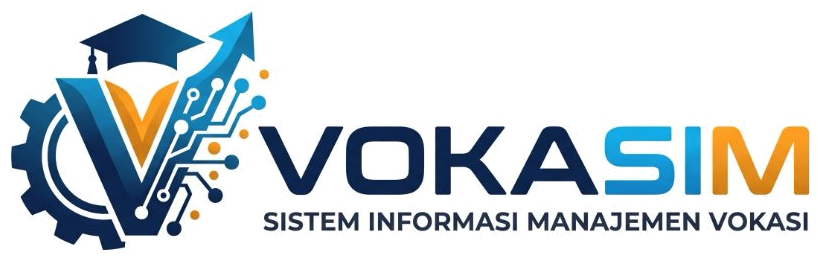

<div align="center">
  

  <p><strong>Sistem Informasi Manajemen Pendidikan Vokasi Terpadu</strong><br>
  Menjembatani Praktikum Kampus, Magang Industri DUDI, dan Kesiapan Karier Berbasis AI</p>

  <p>
    <a href="#fitur-utama"></a>
    <a href="#pengujian--qa"></a>
    <a href="#teknologi-yang-digunakan"></a>
    <a href="#teknologi-yang-digunakan"></a>
    <a href="#teknologi-yang-digunakan"></a>
  </p>
</div>

---

## 📖 Tentang VokaSim

**VokaSim (Vocational Simulation & Management Platform)** adalah platform digital terintegrasi yang dirancang khusus untuk institusi pendidikan vokasi (Politeknik, Sekolah Vokasi, Balai Latihan Kerja, dan SMK Pusat Keunggulan). 

Platform ini menyelesaikan kesenjangan antara kurikulum akademik kampus dengan kebutuhan nyata Dunia Usaha dan Dunia Industri (DUDI), mulai dari pencatatan logbook magang berpresensi geofencing GPS, penilaian rubrik bengkel/lab secara *real-time*, hingga persiapan wawancara kerja teknis dengan **AI Mock Interview**.

---

## 🌟 Fitur Unggulan

### 1. 🤖 Simulasi Wawancara HRD AI (*AI Mock Interview*)
- **Penyesuaian Konteks Otomatis:** Pertanyaan wawancara dihasilkan oleh AI dengan membaca data riil dari portofolio, sertifikat, dan logbook magang mahasiswa.
- **Interaksi Fleksibel:** Mendukung mode Tanya-Jawab Teks serta Audio Suara Interaktif (*Speech-to-Text* & WebRTC Realtime Voice).
- **Asesmen Metode STAR:** Evaluasi terstruktur pasca-wawancara mencakup skor *Situation, Task, Action, Result* (skala 0–100), ketepatan terminologi teknis vokasi, deteksi kata pengisi (*filler words*), dan contoh rekomendasi jawaban optimal.
- **Catatan Pembimbing:** Dosen dapat meninjau rekaman latihan dan memberikan catatan bimbingan langsung.

### 2. 📍 E-Logbook & Presensi Magang Geofencing GPS
- **Pencatatan Aktivitas Harian:** Input deskripsi teknis pekerjaan, akumulasi jam kerja efektif, dan unggah foto dokumentasi lapangan.
- **Validasi Geofencing GPS:** Pengecekan koordinat radius pabrik/kantor mitra industri secara *real-time* untuk mencegah presensi fiktif.
- **Alur Persetujuan Bertingkat:** *Draft* &rarr; *Validasi Mentor Industri DUDI* &rarr; *Verifikasi Dosen Pembimbing*.

### 3. 🛠️ Modul Praktikum Bengkel/Lab & Asesmen Rubrik
- **Katalog Modul Praktikum:** Manajemen modul keahlian terstruktur per semester dan bidang keahlian.
- **Viewer K3 & SOP Laboratorium:** Akses langsung ke standar operasional prosedur dan panduan keselamatan kerja.
- **Penilaian Digital Real-Time:** Formulir pengisian rubrik dosen (*hard skill* & *soft skill*) yang responsif dan ramah tablet saat mengawasi mahasiswa di bengkel.

### 4. 📜 Portofolio Digital & Sertifikasi Ber-QR Code
- **Showcase Proyek Mahasiswa:** Galeri dokumentasi karya, tugas akhir, dan inovasi terapan.
- **Sertifikat Digital Anti-Pemalsuan:** Dompet penyimpanan sertifikat kompetensi ber-QR Code dengan halaman verifikasi publik instan.
- **Rekomendasi Karier Cerdas:** Pemetaan otomatis peluang kerja DUDI berdasarkan capaian unit kompetensi yang telah divalidasi.

### 5. 🏢 Kemitraan Industri & Executive Analytics
- **Pelacakan Dokumen Kerja Sama (MoU/MoA):** Peringatan otomatis masa kedaluwarsa dokumen kemitraan dan pengaturan kuota magang industri.
- **Tracer Study & Analisis Kebutuhan Pasar:** Pelacakan waktu tunggu kerja alumni dan pemetaan kesenjangan keahlian (*skill gap analysis*) secara visual.

---

## 👥 Hak Akses 4 Persona Pengguna

| Role | Tanggung Jawab & Fitur Utama |
| :--- | :--- |
| **🎓 Mahasiswa** | Dashboard capaian kompetensi, isi logbook magang GPS, kelola portofolio, simpan sertifikat, dan latihan wawancara HRD AI. |
| **👨‍🏫 Dosen / Instruktur** | Jadwal kelas bengkel, input nilai rubrik praktik, verifikasi logbook magang, dan evaluasi hasil latihan AI mahasiswa bimbingan. |
| **🏢 Mentor DUDI** | Validasi presensi GPS, persetujuan aktivitas harian/jam kerja magang, dan evaluasi kinerja industri bulanan & akhir magang. |
| **📊 Eksekutif / Admin** | Executive Analytics, tracer study, manajemen dokumen MoU/MoA mitra industri, dan tata kelola akun pengguna. |

---

## 🛠️ Arsitektur & Teknologi

- **Backend:** [Laravel 12 / 13](https://laravel.com/) pada **PHP 8.4**
- **Frontend & Reaktivitas:** [Livewire 3 / 4](https://livewire.laravel.com/) dengan [Volt](https://livewire.laravel.com/docs/volt)
- **Komponen Desain & UI:** [Flux UI](https://fluxui.dev/) + [Tailwind CSS v4](https://tailwindcss.com/)
- **Layanan AI:** OpenAI API / Compatible REST Provider (`gpt-4o`, `whisper`, WebRTC realtime)
- **Penyimpanan Data:** SQLite (Development/Testing) / MySQL / PostgreSQL (Production)
- **Pengujian (Testing):** [Pest PHP](https://pestphp.com/) dengan **428 tests (2.136 assertions passing)**
- **Standar Kode:** [Laravel Pint](https://laravel.com/docs/pint)

---

## 🚀 Panduan Instalasi Lokal

### Prasyarat Sistem
- PHP >= 8.4 (ekstensi: `sqlite3`, `curl`, `mbstring`, `openssl`, `bcmath`)
- Composer
- Node.js (>= 20) & NPM

### Langkah-langkah

1. **Clone Repositori:**
   ```bash
   git clone https://github.com/LilAlamin/vokasim.git
   cd vokasim
   ```

2. **Instal Dependensi PHP & JavaScript:**
   ```bash
   composer install
   npm install
   ```

3. **Konfigurasi Environment:**
   ```bash
   cp .env.example .env
   php artisan key:generate
   ```

4. **Migrasi Database & Seeding Data Awal:**
   ```bash
   touch database/database.sqlite
   php artisan migrate --seed
   ```
   *Seeder akan otomatis menyiapkan data contoh akun (Mahasiswa, Dosen, Mentor DUDI, Admin), kelas praktikum bengkel, logbook magang, mitra DUDI, dan 1 sesi simulasi wawancara AI.*

5. **(Opsional) Konfigurasi Layanan AI:**
   Jika ingin mencoba simulasi wawancara dengan koneksi AI langsung, tambahkan API key di file `.env`:
   ```env
   OPENAI_API_KEY=sk-...
   # Bisa menggunakan endpoint OpenAI resmi atau compatible endpoint (Gemini, Groq, dsb)
   OPENAI_BASE_URL=https://api.openai.com/v1
   ```

6. **Jalankan Aplikasi:**
   ```bash
   # Jalankan server frontend Vite
   npm run build # atau: npm run dev

   # Jalankan web server Laravel
   php artisan serve
   ```
   Buka peramban Anda di **`http://127.0.0.1:8000`**.

---

## 🧪 Pengujian & QA

Aplikasi ini dilengkapi pengujian fitur dan unit komprehensif menggunakan **Pest**:

```bash
# Menjalankan seluruh pengujian
php artisan test

# Menjalankan pengujian spesifik fitur wawancara AI
php artisan test --filter=Interview

# Format kode otomatis dengan Pint
vendor/bin/pint
```

---

## 📄 Lisensi

Proyek ini dirilis di bawah lisensi terbuka [MIT License](LICENSE).
