# Dokumentasi & Bukti Tampilan Sistem VokaSim (14.1 - 14.10)

Dokumen ini memuat bukti tangkapan layar (screenshot) implementasi fitur antarmuka platform VokaSim sesuai spesifikasi pengujian 14.1 hingga 14.10. Seluruh tampilan ditangkap langsung dari environment pengujian lokal pada resolusi tinggi (HiDPI Retina).

---

## Ringkasan Fitur dan Lingkungan Pengujian

| Komponen | Spesifikasi / Status |
| --- | --- |
| Aplikasi | VokaSim (Sistem Simulasi Vokasi Terpadu) |
| URL Environment | http://vokasim.test |
| Resolusi Capture | 1280 × 800 (Device Scale Factor 2.0x) |
| Total Item Pengujian | 10 Modul Utama (16 Tampilan Antarmuka) |
| Tanggal Pengujian | 7 November 2026 |

---

## 14.1 Registrasi Multi-Peran (pages/auth/register)

- **Aktor:** Pengguna Umum (Belum Login / Guest)
- **Kondisi & Elemen Tampilan:**
  - Tiga kartu pilihan peran utama: Mahasiswa, Dosen, dan Mentor DUDI.
  - Kartu Mahasiswa aktif terpilih (highlight border biru dan radio checked).
  - Kolom isian khusus Mahasiswa ditampilkan secara dinamis: Nomor Induk Mahasiswa (NIM) dan Program Studi.

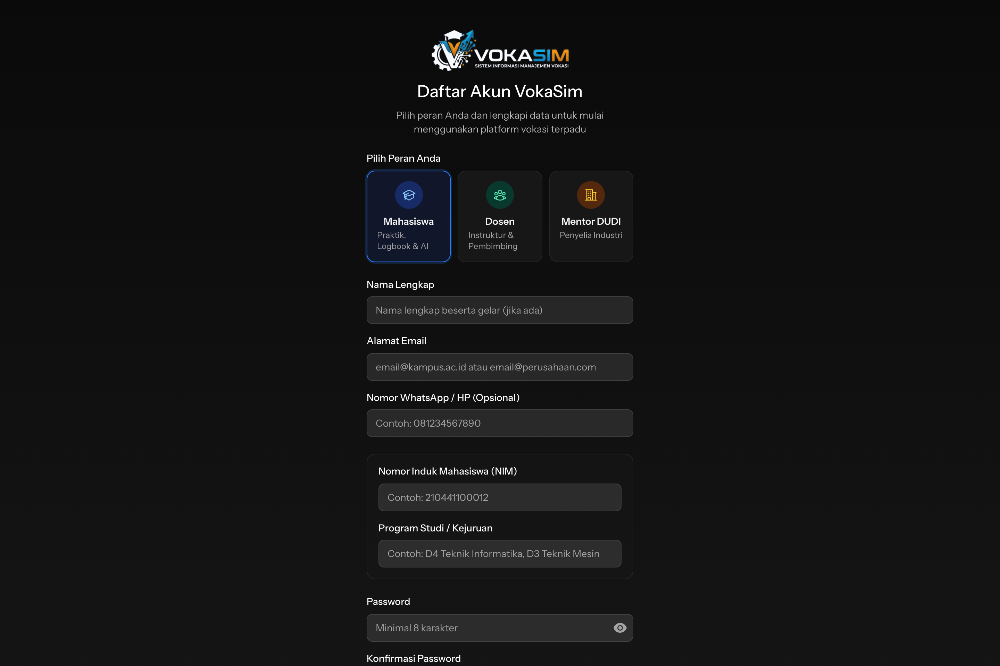

---

## 14.2 Dashboard Mahasiswa (dashboard/mahasiswa)

- **Aktor:** Mahasiswa
- **Kondisi & Elemen Tampilan:**
  - Bar notifikasi Mode Pratinjau Role pada bagian atas navigasi.
  - Empat kartu ringkasan capaian: Indeks Kompetensi, Total Jam Magang, Sertifikat Terbit, dan Skor Rata-rata Wawancara AI.
  - Widget pelacak progres modul kelas praktikum aktif.
  - Panel pintasan Simulasi Wawancara AI beserta riwayat latihan terakhir.

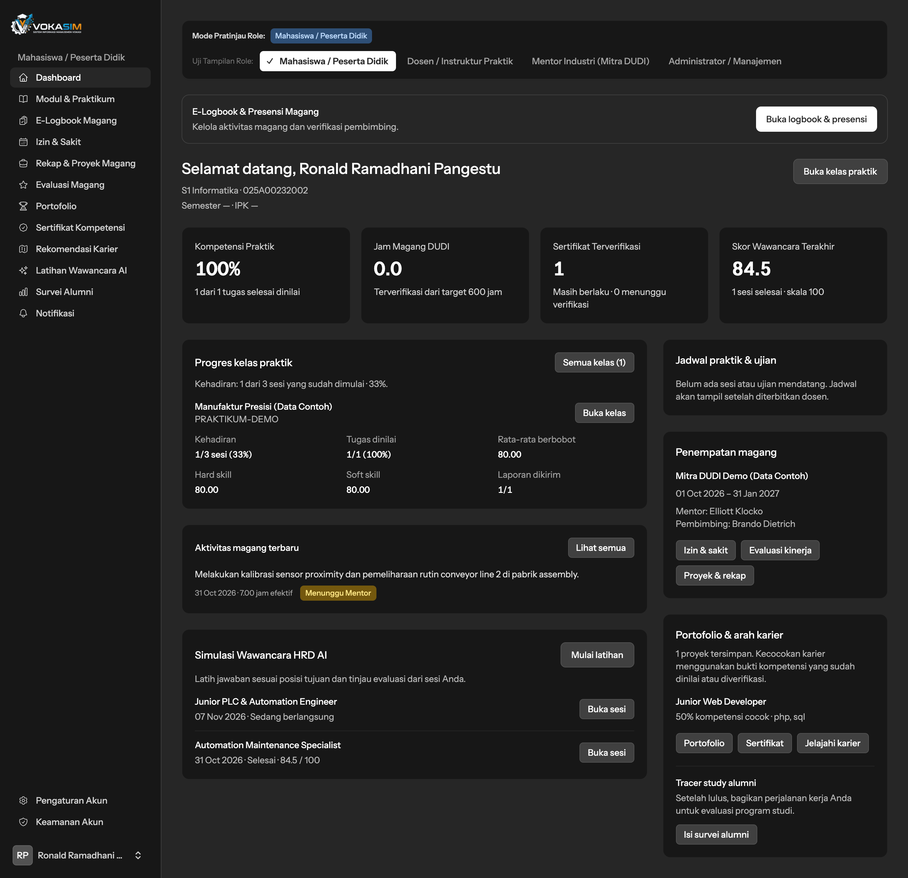

---

## 14.3 Kelas Praktikum (practicums/show, assignment)

- **Aktor:** Mahasiswa / Dosen
- **Data Uji:** Modul Seeder Manufaktur Presisi
- **Kondisi & Elemen Tampilan:**
  - Navigasi 4 tab kelas: Modul Ajar, SOP & K3, Penugasan Praktikum, dan Diskusi.
  - Modal pembaca dokumen standar PDF K3/SOP dalam keadaan terbuka dan terbaca jelas.
  - Lembar rincian skor evaluasi tugas mencakup rubrik hard skill (akurasi dimensi, teknik pengerjaan) dan soft skill (keselamatan kerja K3, kedisiplinan).

### A. Pembaca SOP & K3 Interaktif

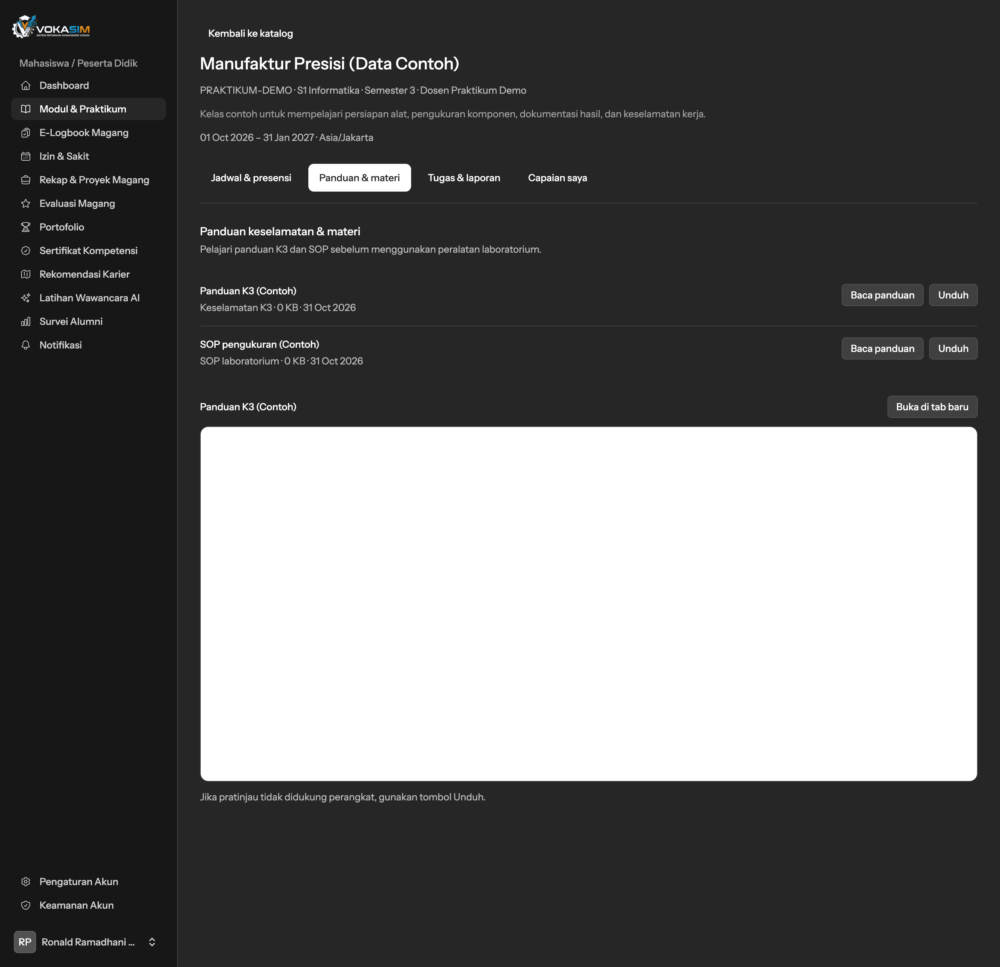

### B. Lembar Rincian Rubrik Hard Skill dan Soft Skill

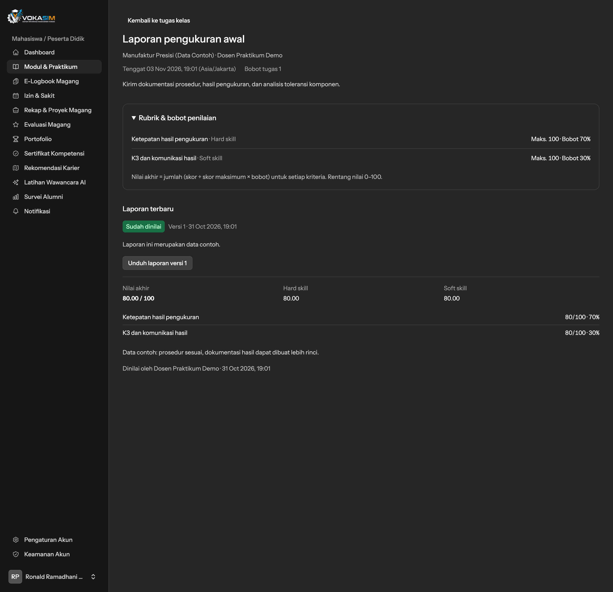

---

## 14.4 E-Logbook dan Presensi GPS (internships/logbook)

- **Aktor:** Mahasiswa Magang Industri
- **Kondisi & Elemen Tampilan:**
  - Panel validasi geofencing GPS: status koordinat real-time, jarak ke titik lokasi industri, estimasi akurasi satelit, dan batas radius kantor.
  - Kalender bulanan interaktif dengan kode warna status pengisian jurnal harian dan presensi.
  - Formulir pencatatan jam kerja efektif disertai lampiran unggahan foto bukti aktivitas pekerjaan di tempat magang.

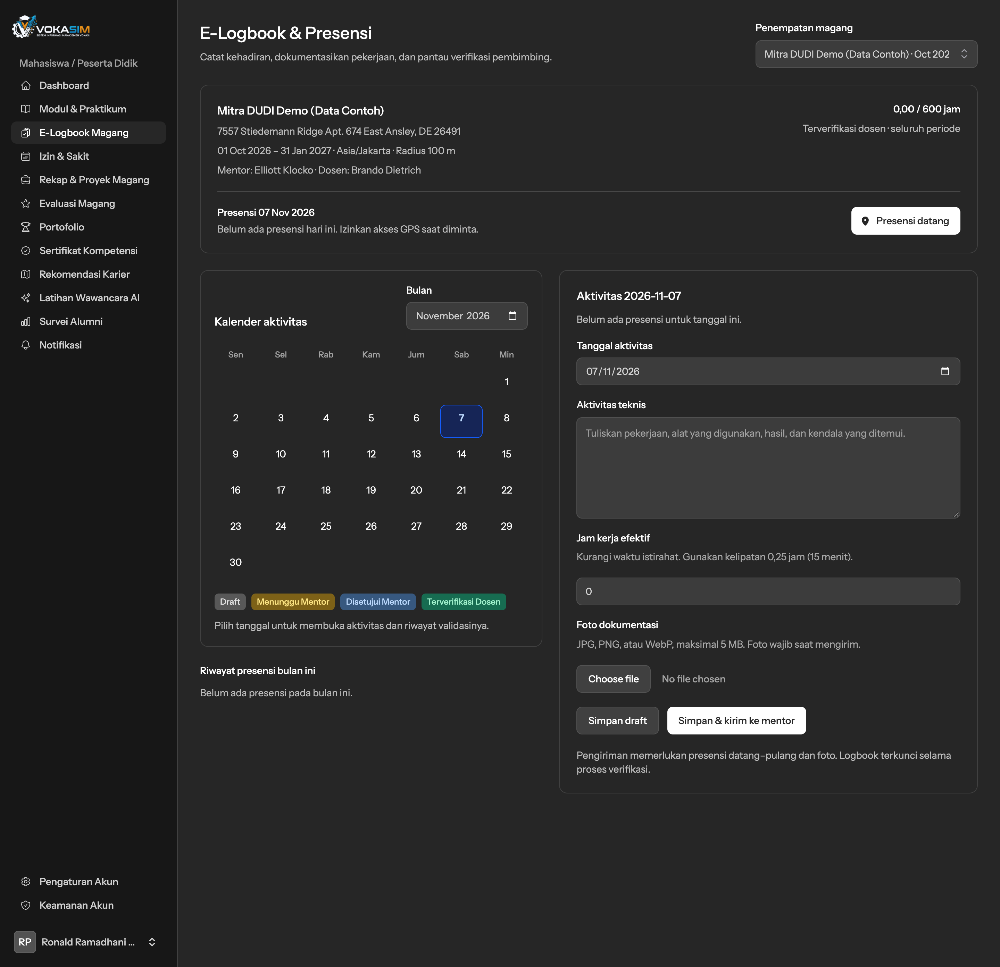

---

## 14.5 Validasi Logbook Massal (internships/reviews)

- **Aktor:** Mentor DUDI (Industri)
- **Kondisi & Elemen Tampilan:**
  - Tabel rekapitulasi jurnal harian magang seluruh mahasiswa bimbingan.
  - Filter antrean status verifikasi (Pending Dosen, Pending Mentor, Disetujui, Ditolak).
  - Fitur seleksi massal checkbox "Pilih halaman ini" untuk persetujuan logbook sekaligus.
  - Panel inspeksi detail koordinat presensi GPS dan pratinjau foto bukti pekerjaan mahasiswa.

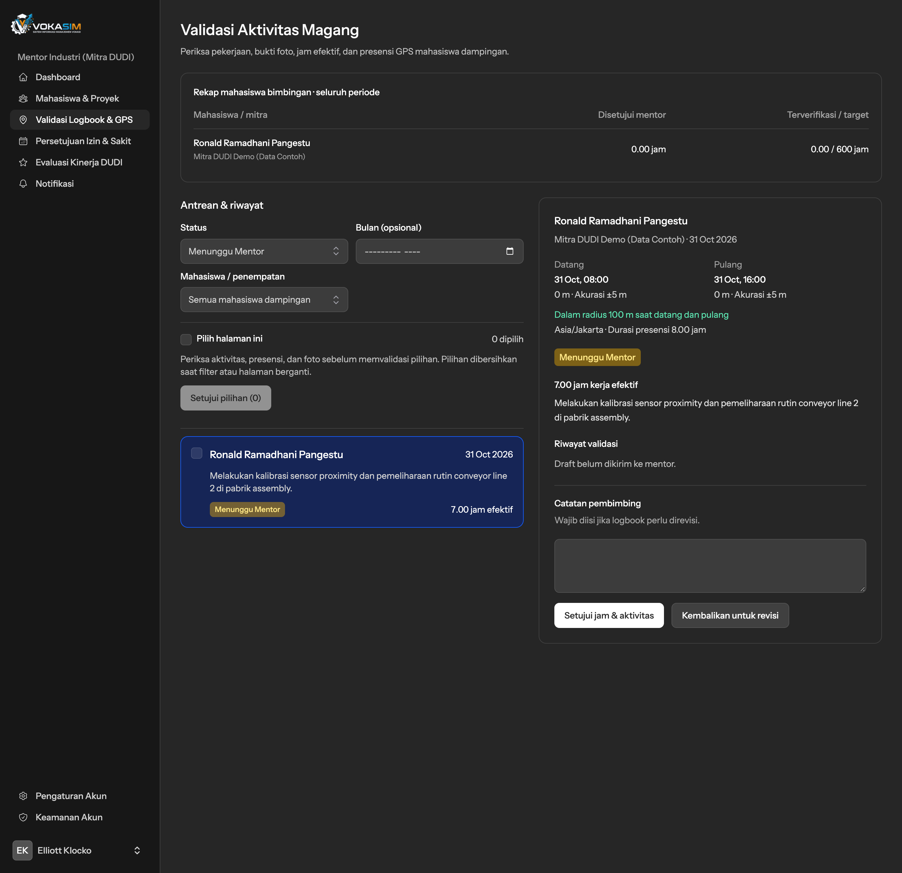

---

## 14.6 Evaluasi Kinerja dan Proyek Lapangan (internships/evaluations, industry/index)

- **Aktor:** Mentor DUDI (Industri)
- **Kondisi & Elemen Tampilan:**
  - Formulir penilaian performa kerja berkala mencakup 5 kriteria standar industri: Inisiatif & Kemandirian, Kehadiran & Kedisiplinan, Komunikasi & Kerjasama, Keterampilan Teknis, serta Penerapan K3.
  - Dasbor rekapitulasi progres akumulasi menit dan jam target penyelesaian proyek lapangan mahasiswa.

### A. Formulir Evaluasi 5 Kriteria Industri

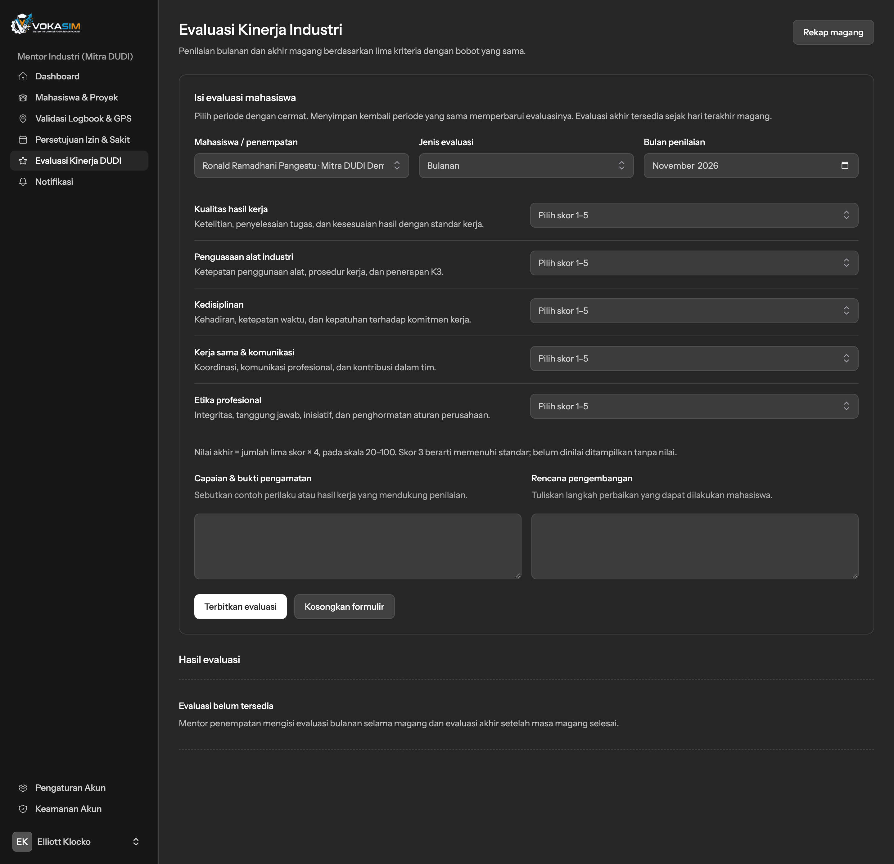

### B. Rekap Progres Proyek Lapangan Mahasiswa

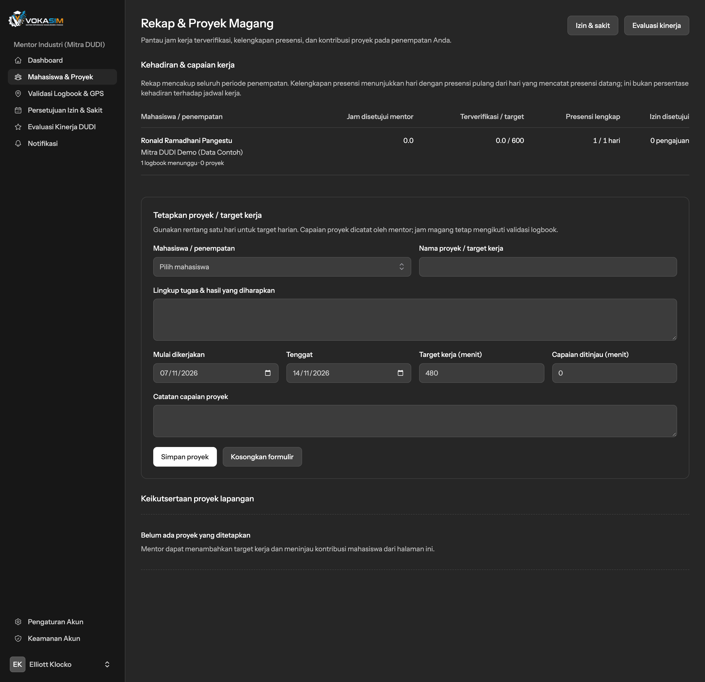

---

## 14.7 Sertifikat Digital dan Halaman Verifikasi Publik (certificates/index, verify)

- **Aktor:** Mahasiswa (Daftar Sertifikat) & Publik / Rekruter (Halaman Verifikasi Tanpa Login)
- **Kondisi & Elemen Tampilan:**
  - Halaman indeks sertifikat mahasiswa menampilkan kode sertifikat unik, tanggal penerbitan, unduh dokumen, dan kode QR verifikasi.
  - Halaman publik verifikasi resmi berstatus "Terverifikasi" (Valid) lengkap dengan metadata pemilik dan institusi penerbit.
  - Halaman publik verifikasi untuk sertifikat berstatus "Dicabut / Kedaluwarsa" (Revoked) dengan tanda peringatan pembatalan.

### A. Indeks Sertifikat Digital Mahasiswa

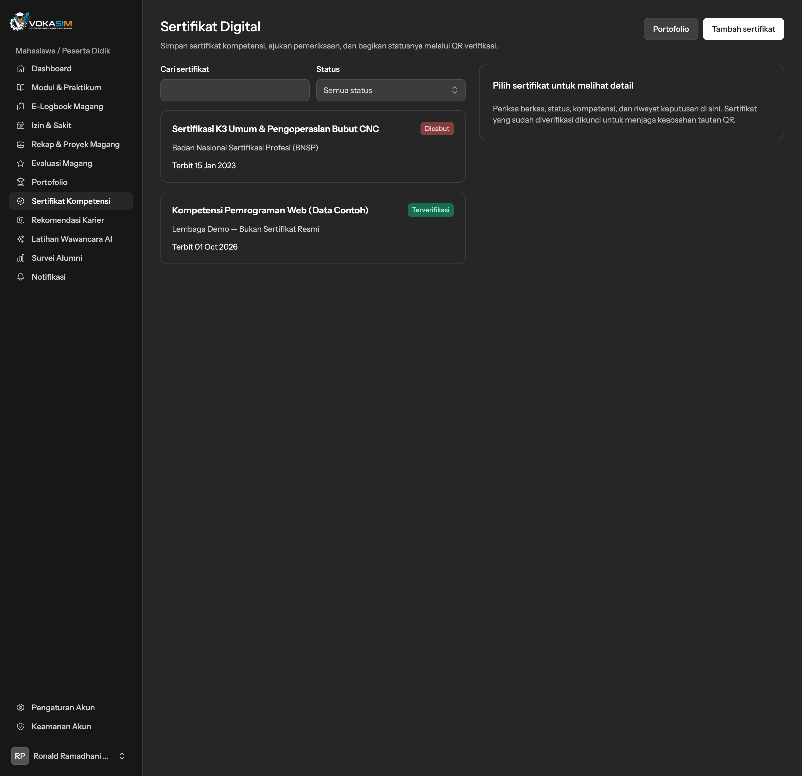

### B. Halaman Verifikasi Publik - Terverifikasi (Valid)

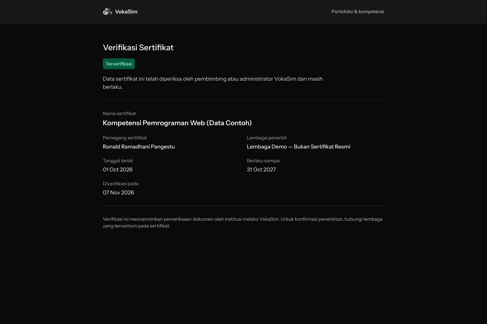

### C. Halaman Verifikasi Publik - Dicabut (Revoked)

---

## 14.8 Rekomendasi Karier Berbasis AI (careers/index)

- **Aktor:** Mahasiswa
- **Kondisi & Elemen Tampilan:**
  - Skor persentase kecocokan profil dengan lowongan industri (Job Fit Index).
  - Lencana (badges) kompetensi vokasi yang telah dikonfirmasi dan terverifikasi oleh sistem.
  - Daftar bukti pendukung portofolio hasil praktikum, jam magang industri, dan skor asesmen simulasi.

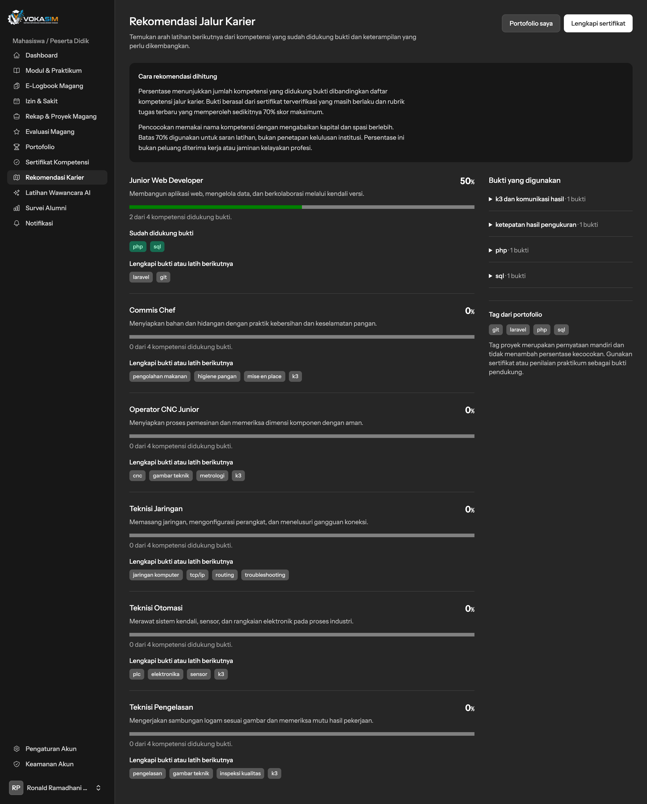

---

## 14.9 Simulasi Wawancara AI (interviews/index, session)

- **Aktor:** Mahasiswa
- **Data Uji Hasil:** Sesi Automation Maintenance Specialist
- **Kondisi & Elemen Tampilan:**
  - Layar pengerjaan simulasi aktif: Penghitung waktu mundur pengerjaan (timer), tombol pemutar audio sintesis AI ("Dengarkan suara AI"), dan antarmuka indikator perekam suara.
  - Layar evaluasi komprehensif AI: Overall Score, pembedahan metode STAR (Situation, Task, Action, Result), skor kecakapan teknis, komunikasi, metrik filler words, kecepatan bicara (WPM), rekomendasi jawaban ideal, serta umpan balik dari dosen pembimbing.

### A. Layar Pengerjaan dan Perekaman Sesi Wawancara

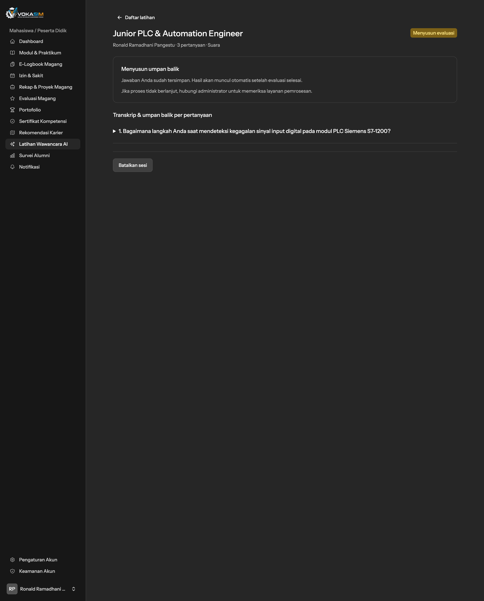

### B. Layar Hasil Evaluasi AI Komprehensif

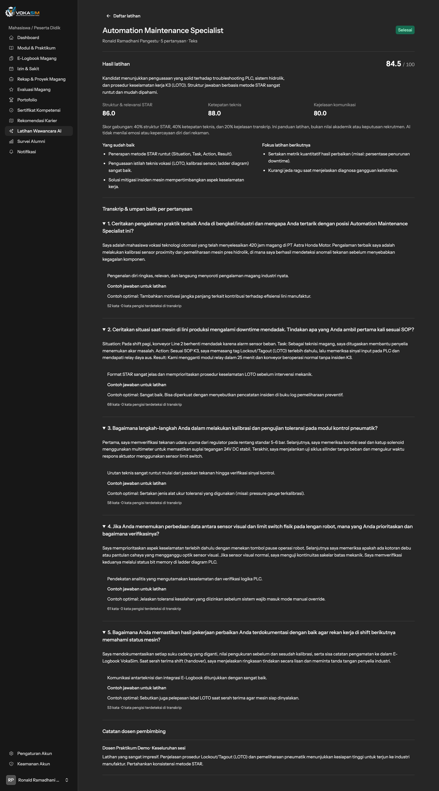

---

## 14.10 Executive Dashboard dan Tracer Study (dashboard/admin, tracer/index)

- **Aktor:** Administrator Institusi
- **Kondisi & Elemen Tampilan:**
  - Executive Dashboard: Indikator persentase serapan lulusan vokasi ke dunia kerja, diagram rata-rata skor kesiapan wawancara per program studi, dan kartu peringatan dini masa berlaku perjanjian kerja sama (MoU) industri yang tersisa ≤ 30 hari.
  - Tracer Study: Statistik masa tunggu kerja lulusan, distribusi gaji pertama, serta visualisasi peta geografis sebaran mitra industri vokasi di seluruh wilayah Indonesia.

### A. Executive Dashboard Administrator

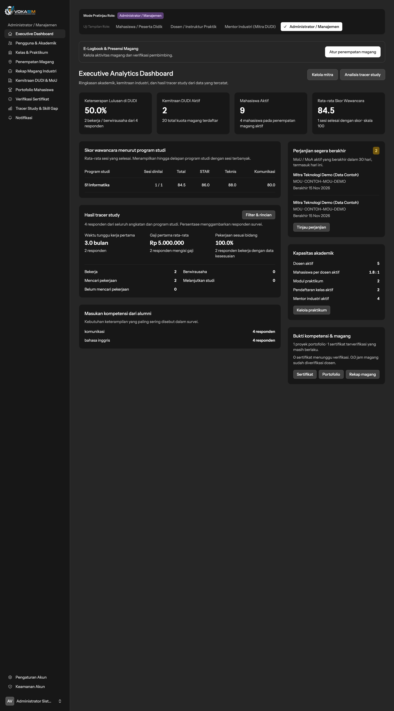

### B. Tracer Study dan Peta Sebaran Mitra Industri

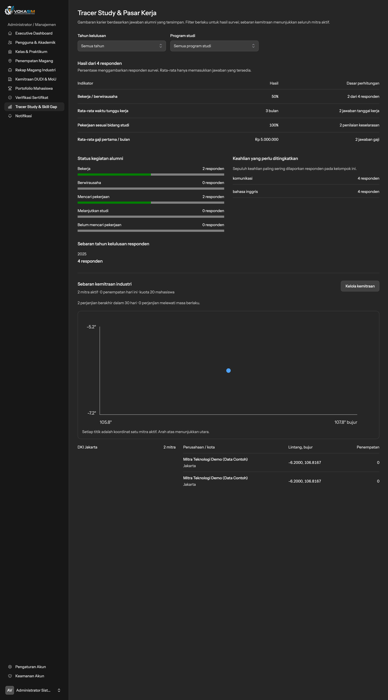
